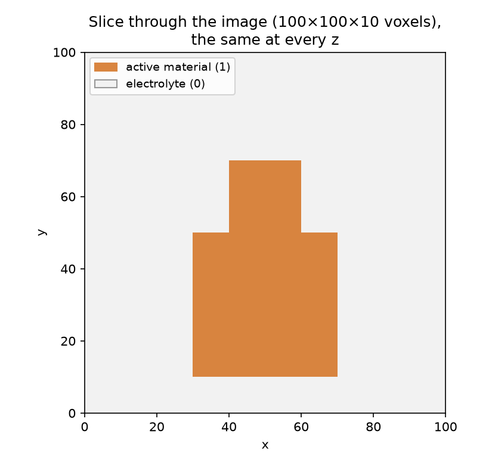
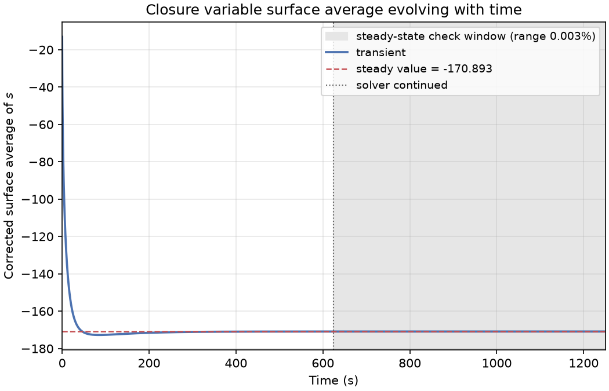
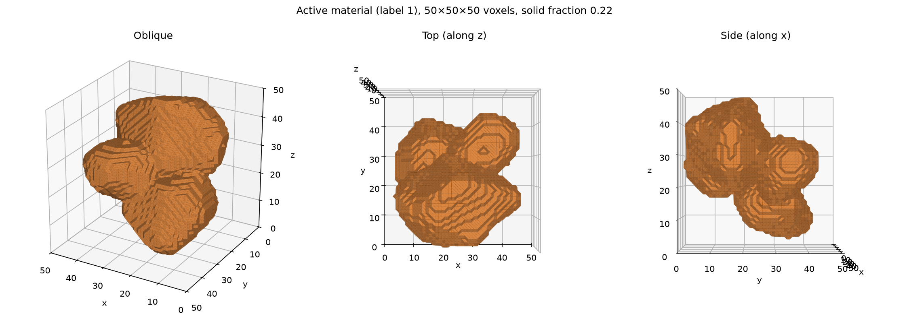
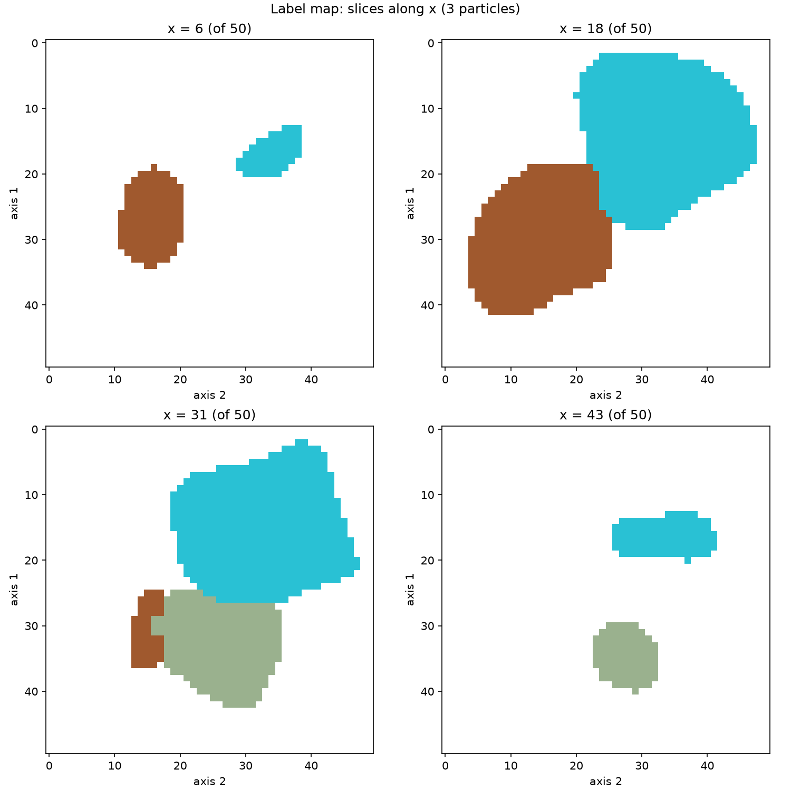
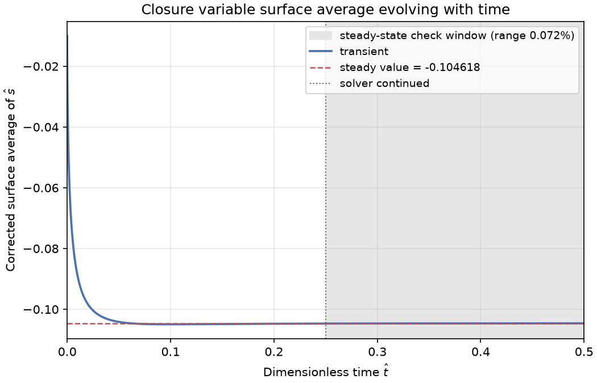

Examples
========

solveclosure is installed with three small example images.
``solveclosure.example_path`` gives the path of each one:

.. code-block:: python

   import solveclosure

   img_path = solveclosure.example_path("two_squares.tif")

The example scripts below are in the ``examples`` folder of the
`solveclosure repository <https://github.com/isaacbasil/solveclosure>`_. They
can be run from any folder. Each one builds its case in a folder of its own,
inside the folder it is run from, and replaces that case when it is run again
(``overwrite=True``).

Two squares
-----------

Two touching active material particles in electrolyte. The particles have
square cross-sections of 40 × 40 and 20 × 20 voxels and run through the whole
thickness of an image of 100 × 100 × 10 voxels of 0.1 µm. The label map is
provided. This example solves the dimensional problem, with
:math:`D_{k}` = 4×10\ :sup:`-14` m\ :sup:`2` s\ :sup:`-1`.

   A slice through the two squares example. The image is the same through its
   whole thickness, so this is effectively a 2D case.

.. literalinclude:: ../examples/two_squares/solve_closure_example.py
   :language: python

The steady corrected surface average, ``global s surface average steady``, is
-170.9 mol s C\ :sup:`-1` m\ :sup:`-1`. The plot saved in the case folder,
``surface_average.png``:

   The corrected surface average of the closure variable against time, for the
   two squares example.

Two squares with a separator
----------------------------

The two squares image is cropped so that the larger particle touches the first
face of axis 0, and a separator layer one voxel thick is added to that face
with ``add_separator_layer``. The larger particle then reacts with the
separator, with a separator surface porosity of 0.4, instead of with the
electrolyte on that face.

.. literalinclude:: ../examples/two_squares/solve_closure_separator_example.py
   :language: python

The steady corrected surface average is -171.4 mol s C\ :sup:`-1` m\ :sup:`-1`.

Three particles
---------------

Three overlapping, irregular active material particles of different sizes
(equivalent diameters of about 20 to 31 voxels) in electrolyte, in an image of
50 × 50 × 50 voxels of 0.1 µm. No label map is provided: the example makes one
with ``generate_label_map``, then solves the dimensionless problem.

   The active material of the three particles example, seen from three
   directions.

.. literalinclude:: ../examples/three_particles/three_particles_example.py
   :language: python

``generate_label_map`` finds the three particles. The image it saves of the
label map, ``three_particles_label_map_slices.png``, shows each particle in its
own colour:

   Four slices along x of the label map generated for the three particles
   example.

The steady corrected surface average is -0.1046:

   The corrected surface average of the closure variable against time, for the
   three particles example.
